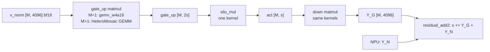

# GPU FFN slice (`kernels/gpu`)

The GPU half of a persistent intermediate-channel FFN split (scope: [agent.md](../../agent.md), [kernel handoff](../../docs/kernel-handoff.md)).
The GPU owns intermediate channels `[0, s)` of one Llama FFN layer (H = 4096, I = 14336). The NPU owns `[s, 14336)`.
Each device computes `Y = (SiLU(X W_gate[:, slice]) * (X W_up[:, slice])) W_down[slice, :]`. The two partial outputs are summed once at the FFN boundary: `x += Y_G + Y_N`.
The handoff's proposed feasibility split, 4096 NPU / 10240 GPU channels, is `s = 10240`.

> **Status (2026-10-17):** built and run on the AUP cloud (Ryzen AI 9 HX 370, Radeon 890M `gfx1150`, ROCm 7.2, Torch 2.11).
> `test_gpu_ffn` passes, quick and full (0 failed). Measurements are in [Results](#results-2026-10-17-hx-370).
> The model switch (`HETEROMEGA_GPU_FFN`) is written but **not yet built or run in the model** (see [Model integration](#model-integration)).
> The NPU half is not part of this directory.



## What is here

| File | Purpose |
|---|---|
| `include/heteromega/gpu_ffn.hpp` | Public API |
| `src/pack_w4a16.cpp` | Packs a W4A16 matrix, or one device's channel slice of an FFN layer, into the HeteroMosaic tile layout. `slice_packed_ffn` cuts a slice out of matrices that are already packed (tile gather, no unpacking) |
| `src/gpu_ffn.cpp` | `packed_linear`, `gpu_ffn_slice_forward` (gate_up matmul → SiLU-and-multiply → down matmul on one HIP stream), `GpuFfnModel` (all layers, for the model loop) |
| `src/gemv_w4a16.cu` | W4A16 GEMV for M = 1: 16-byte weight loads, fp32 accumulation, optional K split |
| `src/silu_mul.cu` | SiLU-and-multiply kernel (bf16, fp32 math), blocked or interleaved gate/up columns |
| `src/residual_add.cu` | Boundary sum on the GPU (R-GPU): `x += y_g + y_n` |
| `src/residual_add_cpu.cpp` | Boundary sum on the CPU (R-CPU): same math, AVX-512 with scalar fallback |
| `tests/test_gpu_ffn.cpp` | Correctness tests: level 1 (each kernel vs fp32, packers byte-equal) and level 2 (`Y_G + Y_N` vs the unsplit FFN, `GpuFfnModel` bit-equal to the prefix path) |
| `bench/bench_ffn_ablation.cpp` | Each GPU change measured alone against HeteroMosaic's FFN order on the same weights, plus a dense bf16 reference. Repeated rounds, shuffled order, GPU clock/power/temperature per row |
| `bench/bench_gemv.cpp` | Decode (M = 1) matmuls: `gemv_w4a16` per K split, HeteroMosaic's GEMV, the prefix of the whole packed matrix, dense bf16 |
| `bench/bench_gpu_ffn_slice.cpp` | GPU slice latency for a grid of M and `s`. `--prefix` uses one packed copy of all channels |
| `bench/bench_reduce.cpp` | R-GPU vs R-CPU latency |
| `bench/bench_bandwidth.cpp` | GPU streaming-read bandwidth, alone or next to CPU reader threads or an NPU load |
| `tools/run_gpu_suite.sh` | Runs all benchmarks above in sequence, one CSV each |
| `tools/summarize_bench.py` | Spread over rounds and per-round ratio against `hm` for `bench_ffn_ablation` output |
| `tools/check_packing.py` | CPU check of the layout and the split math (numpy only) |

## GPU branch contract

| Item | GPU side |
|---|---|
| Logical shapes | `x_norm` [M, 4096]. gate and up packed as one [4096, 2n] matrix. down packed as [n, 4096]. `Y_G` [M, 4096]. n = channels of the slice |
| gate/up column order | `kBlocked`: `[gate 0..n) \| up 0..n)]`. `kInterleaved`: per 64 channels, 64 gate columns then 64 up columns. Only `kInterleaved` lets the first `s` channels of one packed copy serve as the slice `[0, s)` (`FfnSliceWeights::prefix`) |
| Weight layout | HeteroMosaic packed layout, the same one the NPU artifacts read: 128 × 64 tiles of 4352 bytes, ordered by tile column % 8, then tile column, then tile row |
| Quantization metadata | Per tile: 64 bf16 scales, then 64 int8 zeros stored twice (128 bytes). Group size 128 = tile height |
| Activation dtype and strides | bf16, row-major, contiguous. For M > 1 the input storage must hold `padded_rows(M)` rows (multiple of 128), because the GEMM reads whole 128-row tiles |
| Buffer ownership | The caller owns `x_norm`, `Y_G` and the scratch `GpuFfnBuffers` (allocate once for the largest M; reuse across layers and calls). `GpuFfnModel` keeps one set of scratch buffers per stream |
| Readiness and completion | `gpu_ffn_slice_forward` enqueues 3 kernels (plus one copy if `x_norm` is not padded) on the given HIP stream and does not synchronize. The caller records an event. `residual_add2` must start only after both `Y_G` and `Y_N` are complete |
| Boundary sum | `residual_add2(x, y_g, y_n)`: fp32 math, one bf16 rounding. `y_n` can be bf16 or fp32 |
| Split points | Multiples of 128. Prefill and decode can use different split points with one weight copy (`GpuFfnModel::set_split`) |

Numerical contract of the tests, against an fp32 reference computed from the same quantized weights:

- Matmuls and the FFN (levels 1 and 2): `max|got − ref| / max|ref| ≤ 1e-2`, relative L2 error ≤ 1e-2, cosine ≥ 0.9999.
- SiLU-and-multiply and the boundary sum (one bf16 rounding): the same max limit, relative L2 error ≤ 5e-3, cosine ≥ 0.99999.
- Packers (`pack_ffn_slice` vs `slice_packed_ffn`) and the prefix path vs `GpuFfnModel`: bitwise equal.

Inputs are random signed values. Weights, scales (0.002 to 0.02) and zeros (6 to 9) are nonuniform. The GPU tests check the GPU half only.

## Results (2026-10-17, HX 370)

All numbers: random weights in the packed layout, Llama-3-8B FFN shapes, CUDA-event timing with all iterations enqueued back to back. The GPU clock was 2.6 to 2.8 GHz unless noted.

### FFN ablation (`bench_ffn_ablation`, 5 rounds)

Per-round ratio of total FFN time to HeteroMosaic's order (`hm`), median over rounds [min, max]. Less than 1 is faster.

| M | s | merged | fused | gemv (fused + `gemv_w4a16`) | dense bf16 | hm total (ms) |
|---|---|---|---|---|---|---|
| 1 | 10240 | 0.986 | 0.983 [0.974, 0.991] | **0.864** [0.858, 0.869] | 3.216 | 0.820 |
| 1 | 14336 | 0.976 | 0.977 [0.971, 0.982] | **0.874** [0.872, 0.874] | 3.253 | 1.128 |
| 128 | 10240 | 1.006 | 0.980 [0.909, 1.025] | | 1.011 | 3.742 |
| 128 | 14336 | 0.999 | 0.980 [0.932, 1.005] | | 1.067 | 5.200 |
| 512 | 10240 | 0.996 | 0.980 [0.976, 0.987] | | **0.774** | 14.587 |
| 512 | 14336 | 0.997 | 0.980 [0.971, 0.982] | | **0.784** | 20.222 |
| 2048 | 10240 | 0.996 | 0.980 [0.978, 0.982] | | 1.280 | 57.294 |
| 2048 | 14336 | 0.998 | 0.983 [0.982, 0.985] | | 1.365 | 80.071 |
| 4096 | 10240 | 0.997 | 0.982 [0.980, 0.982] | | 1.103 | 114.658 |
| 4096 | 14336 | 0.998 | 0.983 [0.982, 0.985] | | 1.176 | 160.632 |

- The fused SiLU-and-multiply saves about 2 % at every M. Merging gate and up into one GEMM saves 1 to 2 % at M = 1 and nothing at M ≥ 128.
- `gemv_w4a16` saves 13 to 14 % of the decode FFN.
- At M = 512 the W4A16 GEMM is 28 to 29 % slower than dense bf16 (`torch::mm`, hipBLASLt), although it reads 3.8 × fewer weight bytes. This is the GEMM tuning target.
- Round 0 ran at 2.1 to 2.3 GHz instead of 2.6 to 2.85 GHz, which gave the 11 to 16 % spread at M = 128 and 512, s = 10240. The per-round ratios cancel it.
  - In the first ~50 s of a run, the package power was 51 to 53 W, the GPU clock about 2.3 GHz and the GPU 65 to 70 °C. Then: 44 to 45 W, 2.6 to 2.85 GHz, 80 °C. The cause is not known (power management of the SoC).
  - A 3 s warm-up (`--clock-warmup`, now the default) brings the clock up from idle, but does not remove this state. Use per-round ratios, or drop round 0: `summarize_bench.py --skip-rounds 1`.

### Decode matmuls (`bench_gemv`, 3 s clock warm-up, GPU clock 2.74 to 2.85 GHz)

| Matrix | HeteroMosaic GEMV | `gemv_w4a16` | Time |
|---|---|---|---|
| gate_up, s = 10240 | 0.512 ms, 87.0 GB/s | 0.464 ms, 96.1 GB/s | −9 % |
| down, s = 10240 | 0.282 ms, 78.9 GB/s | 0.239 ms, 93.3 GB/s | −15 % |
| gate_up, s = 14336 | 0.693 ms, 90.0 GB/s | 0.648 ms, 96.3 GB/s | −7 % |
| down, s = 14336 | 0.397 ms, 78.5 GB/s | 0.332 ms, 94.1 GB/s | −17 % |

- Per layer with all 14336 channels on the GPU: 1.090 ms → 0.979 ms (−10 %).
- The prefix of the whole packed matrix (`prefix`) runs as fast as a separately packed slice. K splits (`split_k` 2, 4, 8) give no gain.
- Dense bf16 (`torch::mm`) reads at 93 to 102 GB/s. `gemv_w4a16` reads at 93 to 96 GB/s.
- `gemv_w4a16` is also more accurate: on down [14336 × 4096], relative L2 error 1.67e-3 vs 3.49e-3 (HeteroMosaic's GEMV accumulates in fp16).

### GEMM kernel variants (`-DHETEROMEGA_GEMM_AUTOTUNE=ON`)

HeteroMosaic's GEMM has 3 variants for K ≥ 2048: `generic` (128 × 128 output tile, the default), `k2048` and `n64`. With AUTOTUNE, it times all 3 at the first call of each shape and keeps the fastest.

- In all 24 FFN shapes (M ∈ {128, 512, 2048, 4096}, gate, up, gate_up and down for s ∈ {10240, 14336}) it kept `generic`. `k2048` and `n64` were 12 to 37 % slower.
- So the AUTOTUNE build runs the same kernel as the default build: `bench_ffn_ablation` (3 rounds, `hm`, `fused`, `dense`) gave the same ratios within 1 %.
- `generic` runs at 9.1 to 9.5 TFLOPS for every M from 128 to 4096. At M = 128 it reads the weights at only 19 GB/s. So the GEMM is compute-bound (int4 unpacking plus WMMA) from M = 128, not bandwidth-bound. hipBLASLt's dense bf16 GEMM reaches about 11.4 TFLOPS at M = 512.
- Kernel variant selection has no headroom. A faster prefill GEMM needs a new kernel design, for example a 256-row M tile so that each unpacked weight tile serves more rows.

### Shared DRAM bandwidth (`bench_bandwidth`, medians of 1 s windows)

| Readers | GPU GB/s | CPU GB/s | Sum |
|---|---|---|---|
| GPU alone | 95.9 | | 95.9 |
| CPU alone, 4 / 8 / 16 threads | | 61.7 / 95.6 / 87.6 | |
| GPU + CPU 4 threads | 68.8 | 28.1 | 96.9 |
| GPU + CPU 8 threads | 67.6 | 27.1 | 94.7 |
| GPU + CPU 16 threads | 66.1 | 26.9 | 93.0 |

One agent alone already reads at about 96 GB/s. Two agents share it; the sum does not grow. If the NPU behaves the same way, splitting a memory-bound decode FFN between GPU and NPU cannot be faster than the GPU alone, and `s_decode` should be 14336. **Not yet measured with an NPU load.**

### One weight copy for two split points

`bench_gpu_ffn_slice --prefix` (all 14336 channels packed once, interleaved; each `s` as a prefix) gives the same latency as a separately packed slice for M ∈ {1, 512}, s ∈ {4096, 10240, 14336}. So prefill and decode can use different split points without a second copy of the weights.

## Model integration

`GpuFfnModel` holds the FFN weights of every layer for the model's forward loop.

- `add_layer(gate, up, down, H, I)` takes HeteroMosaic's packed `QuantizedLinear` weights (`get_packed_params()`, `padPackedWeights` off). It copies gate and up into one interleaved gate_up tensor (`slice_packed_ffn`) and uses down as it is. Extra memory: 2 × H × I × 4352 / 8192 bytes per layer (62 MB for Llama-3-8B, 2.0 GB for 32 layers).
- `set_split(s_prefill, s_decode)` sets the GPU channels per phase. M > 1 uses `s_prefill`, M = 1 uses `s_decode`. Default: all channels.
- `forward(layer, x_norm, y, stream)` computes the GPU share of one layer.

The HeteroMosaic model calls it from `forward_llama3_with_scratch` (`src/unified_llm_w4a16_hetero/unified_llm_w4a16.cpp`) when both are true:

1. The root build is configured with `-DHETEROMEGA_GPU_FFN=ON`. This builds this directory's sources into a library `heteromega_gpu_ffn` that the model library links.
2. The environment variable `HETEROMEGA_GPU_FFN=1` is set when the model runs.

Otherwise the model path is unchanged. `HETEROMEGA_GPU_FFN_SPLIT=<s_prefill>,<s_decode>` keeps only those channels on the GPU. The NPU share is not computed in this path yet, so the outputs are then wrong: use it to time the GPU share only.

**Not executed yet:** the root build with this option and an end-to-end model run need the model weights and the XDNA headers on the AUP instance (see [cloud-baseline.md](../../docs/cloud-baseline.md)).

## Design notes

- The GPU and the NPU read the **same** packed layout. One packer serves both devices.
- Tiles are ordered by column group (tile column % 8). A channel slice is therefore not a contiguous range of the full packed buffer. `pack_ffn_slice` packs each device's slice on its own. `slice_packed_ffn` gathers its tiles from the full packed matrices (`packed_tile_index`).
- `down` of a slice is a K-slice: rows `[begin, end)` and quantization groups `[begin/128, end/128)`.
- The packed GEMM finds a tile from the tile counts of the whole packed matrix. With the whole matrix's counts and a smaller K and N, it computes the leading block (`w4a16_gemm_fused_packed_tiles`). `gemv_w4a16` does the same for M = 1.
- The GEMM reads whole 128-row tiles of its input. Only its output writes check `M`. HeteroMosaic pads the same way (`M_padded` in `hetero_compute.cpp`).
  - `GpuFfnBuffers` rounds its rows up to a multiple of 128.
  - If `x_norm` is not padded, `gpu_ffn_slice_forward` first copies it into `GpuFfnBuffers::x_pad` (one `hipMemcpyAsync`). Pass a padded `x_norm` to skip the copy.
  - `packed_linear` refuses an unpadded input for M > 1.
- `gemv_w4a16`: one block per 64 output columns, 8 groups of 32 threads. Each group takes every 8th tile row. Each thread loads 16 weight bytes per step, accumulates `Σ q·x` and `Σ x` per tile in fp32 and applies `scale · (Σ q·x − zero · Σ x)` once per tile.
- The benchmarks enqueue all timed iterations back to back and read the events after the loop. A sync in the loop would add the host launch time to each kernel time.

### Changes to `src/hipkernels/`

`w4a16_gemm_packed.cu` and its header have three changes. The existing entry points give the same results as before.

1. New `w4a16_gemm_fused_packed_tiles(..., packed_tiles_k, packed_tiles_n, stream)`. `w4a16_gemm_fused_packed` calls it with the tile counts of K and N.
2. The K2048 kernel loops `while k_tile * 128 < K` instead of `k_tile < num_tiles_k`. The old bound read past K when K is a prefix of the packed matrix.
3. `AUTOTUNE` is `#ifndef`-guarded, so a build can set it (`-DHETEROMEGA_GEMM_AUTOTUNE=ON` in this project).

## Build (AUP cloud)

Use the environment of [cloud-baseline.md](../../docs/cloud-baseline.md): the ROCm 7.2 venv with Torch 2.11, native `gfx1150`, no graphics-version override.

1. Set the environment:
   ```bash
   source /notebooks/heteromosaic-venv/bin/activate
   unset PYTHONPATH HSA_OVERRIDE_GFX_VERSION
   export ROCM_PATH=/opt/rocm-7.2.0
   export LD_LIBRARY_PATH=/opt/rocm-7.2.0/lib:/opt/xilinx/xrt/lib
   ```
2. Configure from the repository root. Check that CMake prints `ROCm: /opt/rocm-7.2.0` and `HIP architectures: gfx1150`:
   ```bash
   cmake -S kernels/gpu -B build/gpu
   ```
3. Build. Keep `-j` small: each HIP file includes LibTorch, and the machine has 23 GB of RAM:
   ```bash
   cmake --build build/gpu -j4
   ```

This is a separate CMake project. It does not need `HOME_LIBS`, the XDNA headers or the cloud CMake patch of the root build.

## Run

Nothing else should use the GPU, or many CPU cores, while a benchmark runs.

1. Run the GPU tests. Start with `--quick` (M ∈ {1, 37, 128}, `s` = 7168):
   ```bash
   ./build/gpu/bin/test_gpu_ffn --quick
   ```
2. Run the full tests (M ∈ {1, 37, 128, 512, 2048}, `s` ∈ {512, 7168, 10240, 13824}). They need about 2 GiB of GPU memory:
   ```bash
   ./build/gpu/bin/test_gpu_ffn
   ```
3. Run all benchmarks (about 10 minutes). Each one writes a CSV into the output directory:
   ```bash
   kernels/gpu/tools/run_gpu_suite.sh /notebooks/hm-results/$(date +%F)
   ```
4. Summarize repeated ablation rounds. `--skip-rounds 1` drops round 0 (see the round-0 note in [Results](#results-2026-10-17-hx-370)):
   ```bash
   python3 kernels/gpu/tools/summarize_bench.py ablation.csv --skip-rounds 1
   ```
5. Measure the GPU share of DRAM bandwidth while an NPU load runs: start the NPU load, then run:
   ```bash
   ./build/gpu/bin/bench_bandwidth --seconds 10
   ```

## Known limits

- HeteroMosaic's GEMV (M = 1) accumulates in fp16. Long K (the `down` slice) loses precision. This also affects the baseline. `gemv_w4a16` accumulates in fp32.
- The GPU partial `Y_G` is bf16, because the kernels write bf16. `residual_add2` also accepts an fp32 `Y_N`.
- `residual_add2_cpu` needs CPU tensors (for example pinned host memory). Where `Y_G` and `Y_N` live is an integration decision.
- Split points must be multiples of 128.
- `GpuFfnBuffers::allocate` takes `hidden` (H) for `x_pad`. This adds `padded_rows(max_M) × H × 2` bytes (32 MiB for max M = 4096).
- All results are from the HX 370 (890M, 16 CUs). The proposal's target, the Ryzen AI Max+ 395 (8060S, 40 CUs, 256 GB/s), is not measured.

## Next steps

1. Build the HeteroMosaic model with `-DHETEROMEGA_GPU_FFN=ON` and run it with and without `HETEROMEGA_GPU_FFN=1` (TTFT, tokens/s, the same greedy tokens).
2. Measure the GPU share of DRAM bandwidth next to an NPU load (needs the NPU side).
3. Make the W4A16 GEMM faster for prefill. Variant selection gives nothing (see above). Profile the `generic` kernel with `rocprofv3` (unpacking vs WMMA vs LDS time), then try a 256-row M tile.
4. Stretch: fuse SiLU-and-multiply into the gate/up GEMM epilogue.
